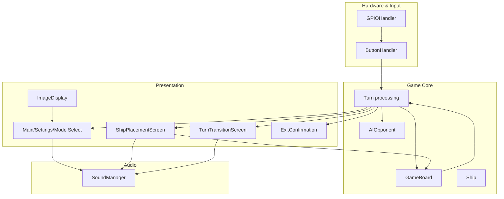
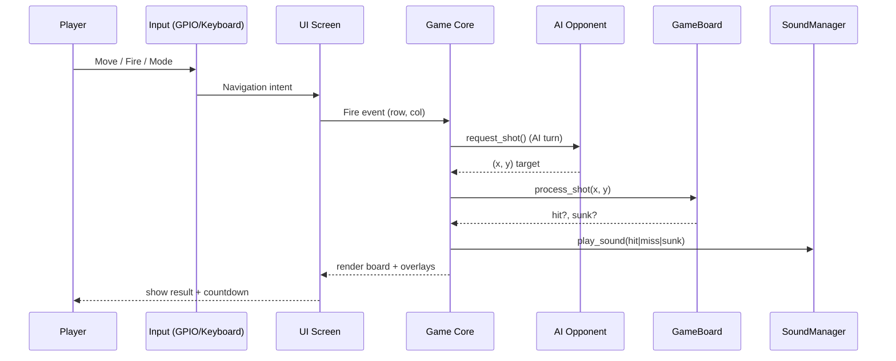
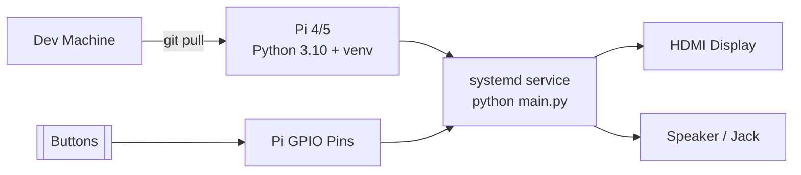

<div align="center">
<br/>

# Pao'er Ship

### Immersive Battleship for Raspberry Pi with cinematic audio, tactile controls, and AI-grade strategy


</div>

---

## About

Pao'er Ship is a production-ready, Raspberry Pi–optimized Battleship experience that blends GPIO hardware controls with a Pygame UI and spatialized audio. It ships with adaptive AI targeting, a two-player hot-seat mode, and a “Pao Mode” boss-level opponent for exhibitions and kiosks. Designed for developers, operators, and makers who need a reliable, zero-network, arcade-grade experience that just works on Pi or desktop.

---

## Key Features

- **High-fidelity Pygame renderer** — 1080p layout, adaptive grid scaling, and polished overlays for menus, placement, and turn transitions.
- **AI difficulty ladder** — Probability-driven targeting for Hard mode, guided follow-ups for Medium, and teaching-friendly randomness for Easy and “Pao” boss play.
- **Hardware-first inputs** — GPIO-driven controls with keyboard fallback, edge-detected debouncing, and configurable move delays for low-latency play.
- **Cinematic sound pipeline** — Layered SFX (fire, hit, miss, sunk) and looping music with Pi-specific buffer tuning and graceful fallbacks.
- **Dual-player workflows** — Guided ship-placement handoff, privacy overlays, and turn-result interstitials to keep both players in sync.
- **Dynamic customization** — Runtime background color selection, adjustable music/SFX volumes, and optional shuffle/repeat toggles.
- **Resilient UX** — Exit confirmations, reset confirmations during placement, and defensive fallbacks when assets or audio devices are missing.

---

## Tech Stack

**Languages**


**Frontend / UI**


**Backend / Services**


**DevOps / Runtime**


---

## Architecture

Pao'er Ship is a self-contained game service: GPIO/keyboard events feed a deterministic game core (boards, ships, AI) rendered through Pygame with synchronized audio. The AI uses probability maps (Hard), targeted hunts (Medium), and parity masks to minimize wasted shots. All hardware hooks are edge-detected to avoid ghost presses, and music playback is monitored by a background thread for resilient looping.

**System Architecture**

```mermaid
flowchart LR
    Player[[Player]]
    GPIO[GPIO Buttons\n(gpiod)]
    KB[Keyboard Input]
    Input[Input Layer\nButtonHandler + GPIOHandler]
    Engine[Game Core\nBoards + Ships + Turn Logic]
    AI[AIOpponent\n(probability map + hunting)]
    UI[UI Screens\nMenus, Placement, Transitions]
    Audio[SoundManager\nSFX + Music Monitor]
    Render[Pygame Renderer\n1080p canvas]
    Assets[Assets\nsounds + images]

    Player -->|press| GPIO
    Player -->|press| KB
    GPIO --> Input
    KB --> Input
    Input --> Engine
    Engine <--> AI
    Engine --> UI
    UI --> Render
    Engine --> Audio
    Audio --> Render
    Assets --> Audio
```

**Component Diagram**



**Turn Lifecycle (AI mode)**



**Deployment (Raspberry Pi target)**



**Performance & Reliability Notes**

- Input debouncing and move delays prevent repeated presses; GPIO edge detection falls back to keyboard when GPIO is absent (`GPIOHandler.get_button_states`).
- Probability map targeting for Hard AI minimizes redundant shots and prioritizes parity squares for coverage.
- Background music is monitored in a daemon thread to auto-recover if playback stops unexpectedly.
- Asset loading has fallbacks for missing files; invalid placements and boundary hits trigger feedback sounds and blocking prompts.

---

## Documentation & Deep Examples

### Core Usage

```python
from src.board.game_board import GameBoard

board = GameBoard()
board.place_ship(x=2, y=5, length=4, horizontal=True)
hit, all_sunk = board.fire(x=2, y=6)
```

```python
from src.game.ai_opponent import AIOpponent, AIDifficulty

ai = AIOpponent(difficulty=AIDifficulty.HARD)
target = ai.get_shot()  # returns (row, col) with probability-weighted targeting
ai.process_shot_result(*target, hit=True, ship_sunk=False)
```

```python
from src.input.button_handler import ButtonHandler

handler = ButtonHandler(gpio_interface=None)  # keyboard fallback
actions = handler.update(keys=pygame.key.get_pressed())
if actions["fired"]:
    # fire at actions["position"]
    ...
```

```python
from src.sound.sound_manager import SoundManager

sounds = SoundManager()
sounds.start_background_music()
sounds.play_sound("hit")
```

### Gameplay Flow (data)

- Input events → translated to `moved`, `fired`, `mode_changed`, and cursor positions.
- Turn engine applies `process_shot` to mutate board state and trigger audio cues.
- `TurnTransitionScreen` displays results with timers and optional mini-board for AI mode.
- `ShipPlacementScreen` gates progression with validity checks and confirmation dialogs.

### Configuration Table (config.py highlights)

| Setting                                   | Default                                                      | Purpose                              |
| ----------------------------------------- | ------------------------------------------------------------ | ------------------------------------ |
| `SCREEN_WIDTH` / `SCREEN_HEIGHT`          | `1920` / `1080`                                              | Target resolution for Pygame surface |
| `FULLSCREEN`                              | `True`                                                       | Run in kiosk-style fullscreen        |
| `BOARD_SIZE`                              | `10`                                                         | Grid dimension (NxN)                 |
| `SHIP_TYPES`                              | Carrier 5, Battleship 4, Cruiser 3, Submarine 3, Destroyer 2 | Fleet composition                    |
| `AI_DIFFICULTIES`                         | Easy, Medium, Hard, Pao                                      | Difficulty ladder                    |
| `BUTTON_MOVE_DELAY`                       | `150ms`                                                      | Debounce for nav inputs              |
| `PIN_UP/DOWN/LEFT/RIGHT/FIRE/MODE/ROTATE` | `17/27/22/23/24/25/26`                                       | GPIO pin mapping                     |
| `AUDIO_SAMPLE_RATE`                       | `44100`                                                      | Mixer sample rate (Pi tuned)         |
| `TARGET_FPS`                              | `30`                                                         | Rendering and input polling target   |

### Example CLI Commands

- Local dev: `python main.py`
- Pinpoint dependencies: `pip install pygame numpy gpiod` (gpiod only on Pi)
- Package assets in-place: store MP3s under `src/sounds/` and images under `assets/images/`.

### Internal Mechanics (highlights)

- **Placement validity**: collision checks prevent overlapping ships; invalid moves play feedback and block progression.
- **AI parity mask**: Hard mode seeds a checkerboard mask to maximize coverage before refining around hits.
- **Music monitoring**: background thread restarts music if the mixer stops unexpectedly, ensuring continuous ambience.
- **Pao Mode**: AI directly targets known player ships for exhibition-level difficulty, with dedicated music theme if present.

---

## Getting Started

### Prerequisites

- Python 3.10+
- `pip` and `venv`
- Raspberry Pi 4/5 with GPIO buttons (optional; keyboard fallback works on any desktop)
- Display + audio output

### Installation

```bash
git clone https://github.com/<your-org>/paoer-ship.git
cd paoer-ship
python -m venv .venv
.\.venv\Scripts\activate  # Windows
# or: source .venv/bin/activate
pip install pygame numpy
# On Raspberry Pi for GPIO input:
pip install gpiod
```

### Environment & Assets

- Sounds: place `background.mp3`, `pao.mp3`, and SFX in `src/sounds/`.
- Images: place `pao.png` in `assets/images/`.
- Configuration: tune `config.py` for screen size, pins, and colors.

### Run (Development)

```bash
python main.py
```

- Keyboard controls: arrows to move, `Space` to fire/select, `Tab` to back, `R` to rotate during placement.

### Run (Production on Raspberry Pi)

- Set `FULLSCREEN = True` in `config.py` (default).
- Launch under `systemd` for auto-restart:
  - ExecStart: `/usr/bin/python /opt/paoer-ship/main.py`
  - WorkingDirectory: `/opt/paoer-ship`
  - Restart: `on-failure`
- Audio: ensure ALSA is configured; mixer pre-init uses smaller buffers on Pi.
- Performance: keep assets local; 30 FPS target with debounced input.

### Scaling & Resilience

- Input latency: keep `BUTTON_MOVE_DELAY` low for arcade feel; increase for kiosks with sensitive buttons.
- Fault tolerance: GPIO failures fall back to keyboard; missing assets degrade gracefully with debug logs.

---

## API Documentation (Core Gameplay Interfaces)

| Interface                        | Purpose                          | Signature                                         | Notes                                       |
| -------------------------------- | -------------------------------- | ------------------------------------------------- | ------------------------------------------- |
| `GameBoard.place_ship`           | Place a ship with overlap checks | `(x: int, y: int, length: int, horizontal: bool)` | Returns `True/False` for valid placement    |
| `GameBoard.fire`                 | Resolve a shot                   | `(x: int, y: int) -> (hit: bool, all_sunk: bool)` | Marks HIT/MISS on board                     |
| `AIOpponent.get_shot`            | Compute AI target                | `() -> (row: int, col: int)`                      | Difficulty-aware; Hard uses probability map |
| `AIOpponent.process_shot_result` | Update AI memory                 | `(x: int, y: int, hit: bool, ship_sunk: bool)`    | Drives hunting/parity adjustments           |
| `GPIOHandler.get_button_states`  | Edge-detected input              | `() -> dict[str, bool]`                           | Falls back to keyboard on non-Pi            |
| `SoundManager.play_sound`        | Play SFX                         | `(sound_name: str)`                               | Uses preloaded MP3s with volume controls    |

**Error Handling & Limits**

- Inputs are debounced; repeated presses inside `BUTTON_MOVE_DELAY` are ignored.
- AI falls back to random targeting if probability computation fails.
- Music playback auto-restarts if the mixer stops.
- No external rate limits; game loop runs at the configured FPS.

---

## Project Structure

```
/assets
  /images              # Static imagery (pao.png, etc.)
config.py              # Centralized constants, pins, colors, tuning
main.py                # Entry point: menu wiring, audio bootstrap
/src
  /board               # GameBoard grid + Ship entities
  /game                # Game state enums, AI difficulty
  /hardware            # GPIO abstraction with keyboard fallback
  /input               # Button handler and cursor management
  /sound               # Audio pipeline (SFX + music monitor)
  /ui                  # Menus, placement, transitions, exit dialogs
  /utils               # Image display helpers
  /sounds              # MP3 assets (fire, hit, miss, sunk, music)
venv/                  # Optional virtual environment (local only)
```

---
